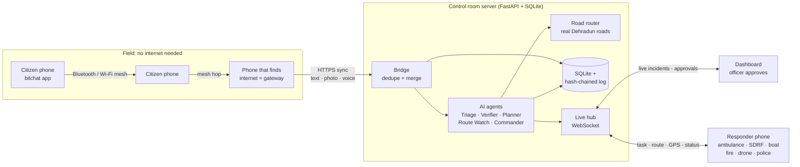
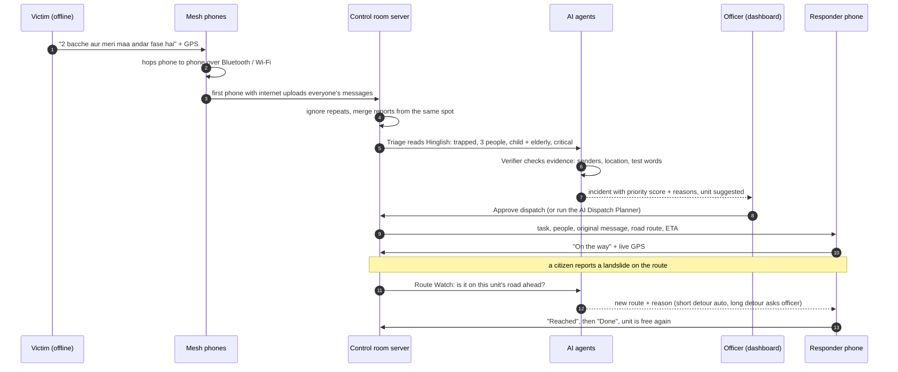
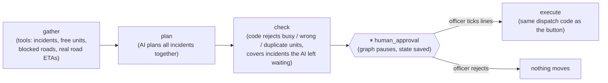
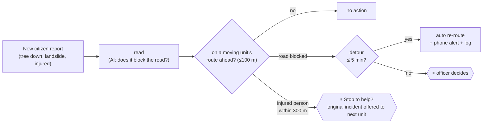
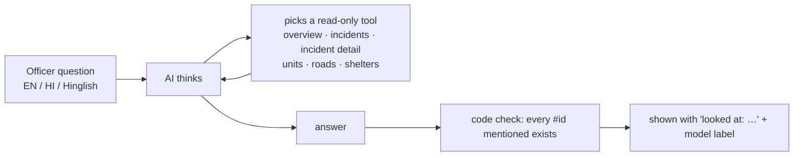
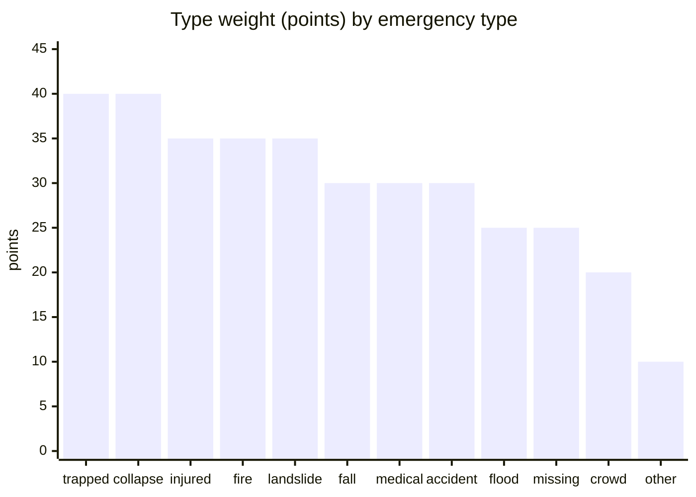
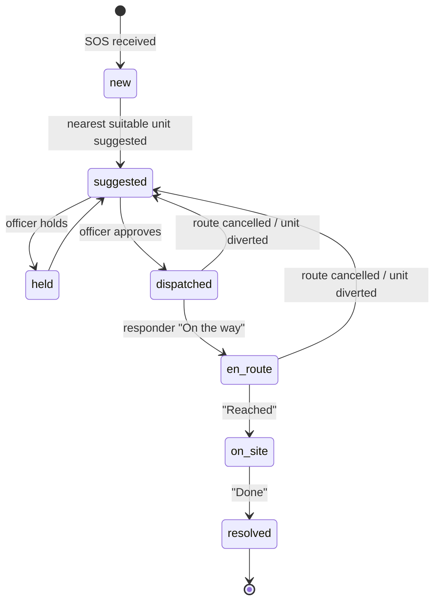
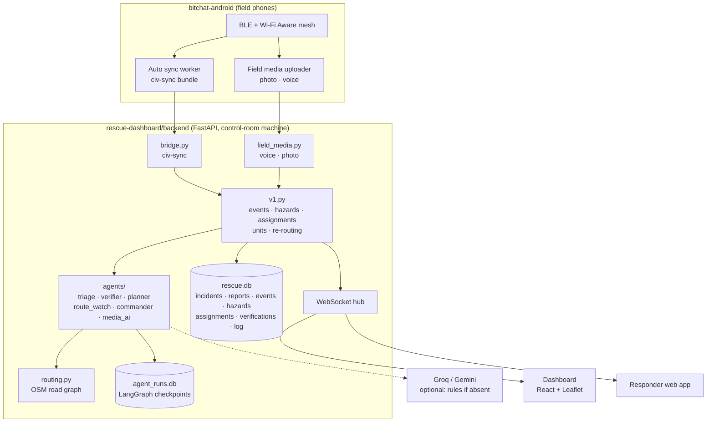

# RESQ · Dehradun Disaster Control Room

**Offline SOS over a phone mesh → AI-assisted control room → live tasks and re-routing on responder phones.**

When a cloudburst, flash flood or landslide hits Dehradun, mobile networks are often the first thing to fail.
RESQ keeps the chain from *"someone needs help"* to *"a unit is on the way"* working anyway:

1. **Citizens send an SOS with no internet** (text, photo or voice note) over a Bluetooth / Wi-Fi mesh of phones.
2. **Any phone that finds internet uploads everyone's messages** to the control room.
3. **Five AI agents** read, verify, prioritise and plan. **An officer approves**; nothing moves without a human.
4. **The responder's phone gets the task and a real road route**, and is **re-routed live** when a road is reported blocked.

---


## Contents

- [The problem](#the-problem)
- [How RESQ works](#how-resq-works)
- [What is in this repository](#what-is-in-this-repository)
- [Key features](#key-features)
- [The five AI agents](#the-five-ai-agents)
- [How priority is decided](#how-priority-is-decided)
- [Trust and safety design](#trust-and-safety-design)
- [Before vs after](#before-vs-after)
- [Architecture and data](#architecture-and-data)
- [Tech stack](#tech-stack)
- [Run it](#run-it)
- [3-minute demo for judges](#3-minute-demo-for-judges)
- [Testing](#testing)
- [Honest limits and next steps](#honest-limits-and-next-steps)

---

## The problem

| What goes wrong in a Himalayan disaster | Why it matters |
|---|---|
| Mobile towers and internet go down first | Victims cannot call 112 or post on social media |
| Reports arrive late, duplicated or in Hindi / Hinglish / local languages | Control rooms waste minutes reading, merging and translating |
| Some reports are false or are practice messages | Scarce boats and rescue teams get sent to the wrong place |
| Roads get blocked by landslides and fallen trees while units are driving | Ambulances reach a dead end and lose critical time |
| Officers juggle maps, phone calls and registers | No single live picture, and no record of who decided what |

Dehradun district has known flood-prone spots (Sahastradhara, Tapkeshwar, IT Park area) and accident-prone
stretches. RESQ loads these as map layers, each with its news or police source.

---

## How RESQ works



### The life of one SOS



---

## What is in this repository

| Folder | What it is |
|---|---|
| [`bitchat-android/`](bitchat-android) | The citizen and field app. Based on the open-source **bitchat** mesh messenger, with our disaster features added (below). |
| [`rescue-dashboard/backend/`](rescue-dashboard/backend) | FastAPI server: bridge, priority rules, road routing, the AI agents, voice/photo AI, responder API, tamper-evident log. |
| [`rescue-dashboard/frontend/`](rescue-dashboard/frontend) | Control-room dashboard (React + Leaflet). |
| [`rescue-dashboard/responder/`](rescue-dashboard/responder) | Responder phone web app (installable, live GPS). |
| [`rescue-dashboard/simulator/`](rescue-dashboard/simulator) | Dehradun drill: realistic Hinglish SOS at real places, always labelled **DRILL**. |
| [`rescue-dashboard/tools/`](rescue-dashboard/tools) | Build the Dehradun road graph, fix place positions, edge-to-cloud sync. |

> The `ai-surveillance/` folder is a separate module and is not covered by this README.

---

## Key features

### 1. Works when the network is down (the bitchat app)
Added to bitchat for disaster use:
- **Roles on every message**: Civilian, Ambulance, Fire, Government, Admin, Shelter, Drone, Rescue, with a role filter.
- **Geo-tagged SOS** and an **offline map** (OpenStreetMap with cached tiles) showing incidents, shelters and nearby mesh peers by role.
- **Shelter registry** shared across the mesh (versioned, verified by officials, stored encrypted on the phone).
- **Delivery acknowledgements** routed back along the mesh path, so a sender knows the message travelled.
- **Automatic sync**: whenever a phone gets *validated* internet, it uploads every geo-tagged message, photo and voice note it has seen. **Every online phone is a gateway for the offline phones around it.**
- **Offline Disaster Survival Guide** (earthquake, landslide, flash flood, fire, trauma first aid, rescue signalling), translated into Hindi, Marathi, Tamil and Telugu.

### 2. Nothing lost, nothing counted twice
- Phones re-send old messages on every sync; the server **ignores repeats** (idempotent ids).
- Reports of the same kind **within 150 m and 30 min merge into one incident** with a report count.
- The dashboard shows **how long each message waited offline** before reaching the server.

### 3. Voice notes and photos from the field
- **Voice SOS in any language** → speech-to-text (Groq **Whisper large-v3**, Gemini as fallback) → English translation → the same Triage pipeline as text. The officer can **play the original recording**.
- **Photo hazard check**: a vision model looks at field photos for a fallen tree, landslide, flooded road, damaged bridge and similar. It **suggests a road block at the photo's location**, with the photo as proof. **The officer accepts or dismisses**; nothing is blocked automatically.
- Without an AI key or internet, audio and photos are **still stored and shown**, so nothing is lost.

### 4. Real routing on real Dehradun roads
- The Dehradun road network from **OpenStreetMap** (OSMnx + NetworkX); routes avoid active hazards.
- **Swiggy-style live re-routing**: when a road is blocked, every unit driving through it gets a new route and a phone alert with the reason.
- **Drones fly straight** and ignore road blocks; ground units follow roads.
- **Trust levels for road blocks**: official roles block a road at once; citizen reports need 2 reports or an officer's confirmation.

### 5. Responder phones
- Login per unit; the task arrives in seconds with route, ETA, people, the citizen's own message, sound and vibration.
- **On the way → Reached → Done** updates the dashboard live; the phone shares **live GPS** and the unit moves on the map.
- Responders can report a road block from the field. The officer can also **complete or cancel a route** from the map.

### 6. Control room dashboard
- Priority-sorted queue with type icons, **DRILL** badges, Verifier marks and the AI urgency reading.
- Map: OpenStreetMap / streets / satellite, labelled routes and units, flood and accident layers, shelters, photo-hazard pins.
- **AI agents · live** strip, so you can watch every agent action as it happens.
- Headline numbers: lives at risk, critical, awaiting approval, median time to dispatch, AI actions.
- Light and dark themes, VS Code-style collapsible panels, and a one-click **Present** mode.

---

## The five AI agents

| Agent | Built with | What it does | Who decides |
|---|---|---|---|
| **Triage** | LangChain structured output | Reads SOS in **Hindi, English, Hinglish and typos**; extracts type, people, injured, children/elderly, urgency, landmarks, needs and an English summary | Suggestion only |
| **Verifier** | Code gathers evidence → AI verdict | **Confirmed / Likely real / Unverified / Possible fake** from different senders, official confirmation, spam pattern, location, test words. **Never hides an SOS**; it only warns | Officer |
| **Dispatch Planner** | **LangGraph** graph with `interrupt` + SQLite checkpointer | Plans **all waiting incidents together** using **real road ETAs**, gives a reason per choice, code rejects impossible plans, then **pauses for the officer** | Officer approves line by line |
| **Route Watch** | **LangGraph** graph with `interrupt` | When a citizen reports a hazard **on the road ahead of a moving unit**: short detour = automatic re-route (logged); long detour = asks the officer. Injured person on the route = **"Stop to help?"** suggestion | Officer for anything big |
| **Commander Assistant** | **LangGraph ReAct** agent with read-only tools | Officer asks in English, Hindi or Hinglish: *"Which incidents have no unit?"*, *"Boat kahan hai?"*. One-click **Situation Report** for the DM / SDRF | Read-only: cannot change anything |

Plus the **field media AI** (Whisper speech-to-text, translation and vision photo check) that feeds voice notes and photos into the same pipeline.

### Dispatch Planner graph



### Route Watch graph



### Commander Assistant (ReAct)



In the **Situation Report**, code counts every number from the database; the AI writes only the sentences.
Code then **deletes any AI line containing a number that is not in the real data**.

---

## How priority is decided

Every incident gets a **0–100 score from visible rules**. The AI never sets the number; it can only add a fixed, labelled bonus.

```
priority = type weight + people + extra reports + waiting time + camera confirmed + AI urgency bonus   (max 100)
```



| Factor | Points | Cap |
|---|---|---|
| Emergency type | see chart | 40 |
| People | +2 per person | 20 |
| Extra reports of the same incident | +3 each | 15 |
| Waiting time (so nobody is forgotten) | +2 per 5 minutes | 15 |
| Seen on camera | +10 | 10 |
| Triage Agent read it as critical / high | +15 / +8 | 15 |

Severity: **critical ≥ 70**, high ≥ 50, medium ≥ 30, low < 30. Clicking an incident shows exactly how its score was built,
for example `fire +35 · 2 people +4 · AI read it as critical +15`.

### Incident lifecycle



---

## Trust and safety design

- **Human in the loop**: no unit moves without an officer's approval. The only exception is a short precautionary detour, which is logged.
- **Code checks the AI**: fixed output schemas, a safety check on every plan, id checks on every answer, and number checks on every report.
- **The AI never hides an SOS**: a "possible fake" is still shown, just marked.
- **Every AI output is labelled** ("AI suggestion (Groq · model)" or "rule suggestion").
- **Rules take over automatically** if the AI or the internet fails; the control room keeps working.
- **Tamper-evident action log**: every decision is hash-chained with who made it (officer, rule or AI). The top bar shows **"Log intact"**.
- **Drills can never pass as real**: everything from the drill script carries a DRILL badge.
- **Data stays local**: the database lives on the control-room machine. Only message text, audio and photos are sent to the AI provider for reading.

---

## Before vs after

| Step | Today (typical) | With RESQ |
|---|---|---|
| Sending an SOS when towers are down | Not possible | Mesh SOS, carried phone to phone until one finds internet |
| Reading reports in Hinglish / voice | Manual reading and translation | Triage Agent + speech-to-text, English summary on the card |
| Duplicates and fakes | Counted by hand, often missed | Automatic merge; Verifier marks evidence |
| Choosing which unit to send | Phone calls, guesswork on distance | Real road ETA for each unit; AI plans all incidents together; officer approves |
| A road gets blocked mid-route | Unit discovers it on arrival | Route Watch re-routes live and alerts the responder's phone |
| Briefing the District Magistrate | Written by hand from registers | One-click Situation Report from live data |
| Accountability | Paper registers | Hash-chained log of every decision, human or AI |

---

## Architecture and data



**Why it runs on a control-room machine and not on serverless hosting (e.g. Vercel):**
the dashboards need always-open WebSocket connections, the SQLite database and log need a permanent disk,
the road graph is loaded into memory, and LangGraph agents pause and wait for the officer. Most importantly,
in a disaster **the internet fails first**: an offline-first control room keeps working at the district EOC.
For the demo, a free Cloudflare tunnel gives the laptop a public HTTPS address for the phones.
In production it would run on the district EOC server or the State Data Centre. For a cloud backup there is
`tools/edge_sync.py`, which pushes everything to a cloud copy whenever any internet link appears.

---

## Tech stack

| Layer | Technology |
|---|---|
| Field app | Kotlin, Jetpack Compose, BLE + Wi-Fi Aware mesh (bitchat), WorkManager, OkHttp, osmdroid |
| Server | Python, FastAPI, Uvicorn, SQLite, WebSockets |
| AI agents | LangGraph (StateGraph, `interrupt`, SQLite checkpointer, ReAct), LangChain, Pydantic structured output |
| AI models | Groq `openai/gpt-oss-120b` (text), Whisper large-v3 (speech), Groq vision models (photos); Gemini 2.5 Flash as fallback |
| Routing | OpenStreetMap road graph via OSMnx + NetworkX; straight-line for drones |
| Dashboard and responder | React 18, Vite, Leaflet / react-leaflet |
| Hosting (demo) | Laptop + Cloudflare quick tunnel (free) |

Everything used is free: Groq free tier, OpenStreetMap, Cloudflare tunnel, SQLite.

---

## Run it

**Needs:** Windows with Python 3.10+ and Node 18+. Full guides: [`rescue-dashboard/README.md`](rescue-dashboard/README.md) and
[`rescue-dashboard/DEHRADUN_RUN.md`](rescue-dashboard/DEHRADUN_RUN.md).

**One command (installs, builds, starts and opens a tunnel):**

```powershell
cd rescue-dashboard
.\run.bat -Tunnel
```

**Or manually:**

```powershell
# one time
cd rescue-dashboard\backend
python -m venv .venv
.\.venv\Scripts\Activate.ps1
pip install -r requirements.txt
cd ..\frontend;  npm install; npm run build
cd ..\responder; npm install; npm run build

# every time: terminal 1
cd rescue-dashboard\backend
.\.venv\Scripts\Activate.ps1
$env:ROAD_GRAPH = "roads_dehradun.graphml"   # after building it with tools\build_graph.py
uvicorn main:app --host 0.0.0.0 --port 8001

# every time: terminal 2 (public HTTPS address for the phones)
cloudflared tunnel --url http://localhost:8001
```

**AI key (optional; rules work without it):** create `rescue-dashboard/backend/.env` containing `GROQ_API_KEY=...`.
Never commit this file.

| Open | Address |
|---|---|
| Control-room dashboard | `http://localhost:8001` |
| Responder app (on phones) | `https://<tunnel>/responder/` |
| bitchat Sync URL (in the app's Sync settings) | `https://<tunnel>/api/v1/bitchat/civ-sync` |
| All API endpoints | `http://localhost:8001/docs` |

Responder logins: `AMB1`, `AMB2` (ambulances), `RES3` (SDRF team), `BOA4` (boat), `FIR5` (fire), `DRO6` (drone), `POL7` (police).

---

## 3-minute demo for judges

1. **Reset demo**, then run `python simulator\drill_dehradun.py`. Hinglish SOS arrive at real Dehradun spots; a second report near Tapkeshwar **merges**.
2. Open the top incident: **Triage** reading, **Verifier** verdict, and **why** it has that priority.
3. **AI Planner** tab → *Plan with AI*: watch the graph run, then approve.
4. A responder phone receives the task; tap **On the way** and the unit moves on the map.
5. Send a citizen **"tree fallen on the road"** on the unit's route (or `drill_dehradun.py --citizen`): **Route Watch** re-routes, and the phone shows the new route and reason.
6. Send a **voice note** or a **photo of a blocked road** from the app: transcript, or a camera pin asking the officer to block the road.
7. **Ask AI** tab: *"Which incidents have no unit yet?"*, then **Situation Report**.
8. Show **Log intact** and the **Action log**: every human and AI decision, hash-chained.

---

## Testing

```powershell
cd rescue-dashboard\backend
python -m pytest -q
```

**89 automated tests pass**, covering the bridge, merging, priority, routing and re-routing, all agents (with a fake AI model, so no key or internet is needed),
voice and photo handling, route actions and the AI retry logic.

---

## Honest limits and next steps

- **Local languages**: Hindi, Hinglish, Nepali and English work well. **Garhwali and Jaunsari** have no dedicated speech model; they usually come out as Hindi or Nepali text and are then translated. Next: a local emergency-word glossary checked by native speakers.
- **Voice over the mesh is slow**: audio is much larger than text, so the text SOS travels first and the recording follows when a phone with internet uploads it.
- **Demo hosting**: the free tunnel address changes when restarted. Production would use a fixed government domain on the district EOC server.
- **Responder PINs** are demo defaults and must be changed before real use.
- **Next agent**: a **Risk Predictor** that reads the rain forecast and suggests moving boats and rescue teams **before** flooding starts.
