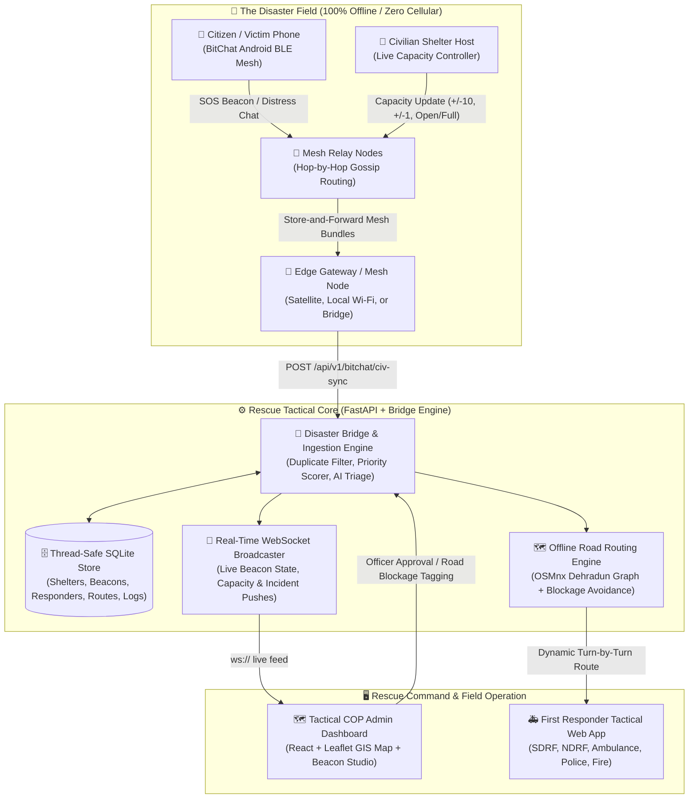

# 🚨 ResQMesh
### Offline-First Mesh Network & Tactical Disaster Response Ecosystem
> **Developed for GEHU Hackathon 2026** | Focused on Resilient Disaster Management for Dehradun & Himalayan Terrains

[](https://fastapi.tiangolo.com/)
[](https://react.dev/)
[](https://developer.android.com/)
[](https://osmnx.readthedocs.io/)
[](https://groq.com/)

---

## 📌 Executive Summary

During severe natural disasters in mountainous terrains—such as **cloudbursts, landslides, flash floods, and seismic events common in Uttarakhand and Dehradun**—critical communication infrastructure collapses:
- ❌ **Cellular towers go offline** and fiber-optic cables snap, isolating civilian populations.
- ❌ **Control rooms operate blind**, receiving stale, unverified, or duplicate emergency reports.
- ❌ **Emergency shelters quickly overflow or run dry**, with zero live visibility into remaining capacity.
- ❌ **First responders encounter flooded or blocked roads**, leading to critical dispatch delays.

**ResQMesh** is a fully integrated, zero-infrastructure disaster response ecosystem that bridges the gap between stranded civilians and tactical rescue commanders through:
1. **Zero-Infrastructure Bluetooth Low Energy (BLE) Mesh Networking** running on everyday Android smartphones.
2. **Dynamic Civilian SOS Beacons with Real-Time Capacity Management** and cryptographic creator ownership.
3. **Common Operating Picture (COP) Tactical Rescue Dashboard** with live radar beacon indicators and real-time capacity badges.
4. **Offline Road Graph & Hazard-Avoiding Routing Engine** powered by OSMnx for Dehradun road networks.
5. **AI-Assisted Emergency Triage & Nearest-Unit Recommendation** for prioritized human-in-the-loop dispatch.

---

## 🏗️ System Architecture & Data Flow



---

## 🚨 Live SOS Beacon & Dynamic Capacity Feedback Loop

When emergency shelters open or disaster victims deploy an emergency marker, resource exhaustion is the #1 danger. ResQMesh features an active **Dynamic SOS Beacon & Live Capacity Studio**:

```mermaid
sequenceDiagram
    autonumber
    actor Creator as Civilian Shelter Host / Victim
    participant Phone as BitChat Android App
    participant Mesh as Bluetooth Mesh Network
    participant Bridge as Tactical Bridge (FastAPI)
    participant Dashboard as Admin COP Map (React)
    actor Responder as SDRF / Rescue Teams

    Creator->>Phone: Launch SOS Beacon (Set Name, GPS, Live Capacity: 40)
    Note over Phone: Signs payload with creator token / originPeerID
    Phone->>Mesh: Broadcast Beacon Advertisement via BLE Gossip
    Mesh->>Bridge: Ingested via civ-sync upload
    Bridge->>Dashboard: WebSocket Push: `beacon_updated`
    Note over Dashboard: Map renders glowing radar pulse with Live Badge: 👥 40
    
    rect rgb(240, 248, 255)
        Note over Creator, Dashboard: 🔄 Dynamic Capacity Modification
        Creator->>Phone: Update Capacity (-10 arrivals -> 30 capacity left)
        Phone->>Mesh: Gossip incremental update with creator token
        Mesh->>Bridge: Synchronized to Bridge
        Bridge->>Dashboard: Instant badge update to 👥 30 (Status: OPEN)
    end

    rect rgb(255, 240, 245)
        Note over Creator, Dashboard: ⛔ Overcrowding Event
        Creator->>Phone: Capacity reaches 0 -> Mark Status: FULL
        Phone->>Mesh: Broadcast FULL status
        Bridge->>Dashboard: Marker turns Orange/Crimson; Alert issued
        Dashboard->>Responder: Auto-diverts incoming evacuees to adjacent open shelters
    end
```

---

## 🌟 Key Innovations & Judge Highlights

### 📡 1. True Zero-Infrastructure Mesh Networking (BitChat Android)
- **100% Off-Grid Communication**: Operates entirely over Bluetooth Low Energy (BLE) peer-to-peer mesh. No cellular signal, SIM card, or Wi-Fi router required.
- **Store-and-Forward Gossip Protocol**: Messages and SOS distress beacons hop from smartphone to smartphone across the disaster perimeter.
- **Civilization Sync (`civ-sync`)**: As soon as any single handset touches an edge connectivity node (satellite truck, base camp Wi-Fi, rescue drone), it automatically flushes all accumulated mesh bundles to the command backend.

### 🚨 2. Dynamic SOS Beacons & Creator-Authenticated Control Page
- **Concentric Radar Map Visualization**: SOS beacons appear on the admin COP map with animated dual-ring radar pulses (`beacon-pulse-ring`) and high-visibility live capacity badges (`👥 <capacity>`).
- **Creator Ownership Token**: When deploying a beacon via browser or mobile app, a cryptographic token (`creator_token` / `originPeerID`) is issued. Only the author can modify its capacity or status, preventing bad actors from falsifying emergency shelter capacity.
- **Real-Time Control Studio**: Features a dedicated control panel with tactile steppers (`-10`, `-1`, `+1`, `+10`), direct capacity sliders, status toggles (`OPEN`, `FULL`, `CLOSED`), emergency notes, and one-tap stand-down/deactivation.

### 🗺️ 3. Tactical COP Command Room & Real-Time GIS Map
- **Common Operating Picture (COP)**: Aggregates civilian SOS reports, active shelters, emergency resources, and responder units into a single live geospatial dashboard.
- **Instant WebSocket Synchronization**: Any new beacon, capacity edit, or incident status change reflects instantly across all open command terminals without full-page reloads.
- **Tamper-Evident Action Logging**: Every dispatch, triage update, and shelter modification is recorded with strict timestamps for full post-incident auditability.

### 🛣️ 4. Offline Road Graph & Hazard-Avoiding Routing Engine
- **Pre-Compiled Dehradun Road Graph (`roads_dehradun.graphml`)**: Powered by OSMnx and NetworkX. Computes accurate topological road routes without depending on Google Maps or online cloud APIs.
- **Dynamic Road Blockage Avoidance**: Command officers can tag collapsed bridges or flooded roads; the routing engine automatically recomputes optimal routes for ambulances, SDRF, and fire tenders.

### 🧠 5. Automated AI Incident Triage & Smart Dispatch
- **AI Triage Engine (Groq AI)**: Analyzes unstructured distress text, determines urgency levels (Critical, Moderate, Low), and extracts casualty counts and critical needs (medical, food, rescue).
- **Nearest Unit Recommendation**: Proposes the closest available SDRF, ambulance, or police unit to the command officer, ensuring fast and coordinated response while keeping humans in the loop.

---

## 🛠️ Complete Tech Stack Matrix

| Subsystem | Core Technologies | Purpose & Architecture Role |
| :--- | :--- | :--- |
| **Mobile Mesh** | Android SDK 34, Kotlin, Jetpack Compose, BLE GATT | Peer-to-peer decentralized mesh communications, SOS beacon generation & live control sheet |
| **Command Backend** | FastAPI, Uvicorn, Python 3.10+, SQLite3 | High-throughput async REST API, WebSocket pub/sub broadcaster, tamper-evident audit logging |
| **Tactical Dashboard** | React 19, Leaflet, Vite, Vanilla CSS Design System | Common Operating Picture (COP) map, pulsing beacon radar markers, capacity stepper studio |
| **Offline Routing** | OSMnx 2.0, NetworkX, Shapely, GeoPandas | Graph-theoretic road routing for emergency vehicles avoiding blocked corridors without internet |
| **AI Incident Triage** | Groq API / Fallback Rules, Pydantic, Python | Urgency ranking, duplicate report grouping, and nearest rescue unit recommendations |
| **Responder Portal** | Mobile-optimized React web app | Field responder mission assignment, turn-by-turn routing, and live status reporting |

---

## 📁 Repository Organization

```text
.
├── app-universal-debug.apk           # Pre-compiled universal Android APK for immediate testing
├── README.md                          # Hackathon Master Documentation (Judges' Guide)
├── screenshots/                       # System demonstrations and user interface captures
├── docs/                              # Supplementary architectural briefs and guides
└── src/
    ├── bitchat-android/               # Native Android Mesh Companion App
    │   └── app/src/main/java/com/bitchat/android/
    │       ├── ui/BeaconControlSheet.kt   # Live Beacon Control Studio (Capacity Steppers)
    │       ├── ui/ShelterSheet.kt         # Shelter discovery & status viewer
    │       ├── ui/ChatScreen.kt           # Tactical mesh messaging & SOS dispatch view
    │       ├── ui/ChatViewModel.kt        # State management & mesh capacity broadcast
    │       └── sync/                      # CivilizationSyncClient (auto bundle flushing)
    │
    └── rescue-dashboard/              # Central Tactical Command Center
        ├── backend/                   # FastAPI Tactical Bridge
        │   ├── bridge.py              # Rest API, WebSocket, Beacon CRUD & capacity authorization
        │   ├── test_beacon.py         # Unit tests for beacon capacity & ownership validation
        │   ├── agents/groq_triage.py  # AI-assisted incident triage & unit recommendation
        │   └── tools/                 # OSMnx graph builder and place coordinates normalizer
        ├── frontend/                  # React + Leaflet COP Dashboard
        │   ├── src/BeaconControl.jsx  # Beacon Studio (live capacity +/- steppers, slider, notes)
        │   ├── src/CityLayers.jsx     # Dual-ring radar beacon markers & capacity badges
        │   ├── src/App.jsx            # Main tactical command container & WebSocket listener
        │   └── src/styles.css         # Glassmorphism design system & radar pulse keyframes
        └── responder/                 # Mobile-first field responder turn-by-turn routing app
```

---

## 🚀 Quick Start & Live Demonstration Guide

Follow these simple steps to run the complete ResQMesh ecosystem locally.

### 📋 Prerequisites
- **Python**: Version 3.10 or higher
- **Node.js**: Version 18 or higher (`npm`)
- **Android Device / Emulator** (Optional): To run `app-universal-debug.apk`

---

### Step 1: Start the Tactical Command Center (Backend + COP Map)

```bash
# 1. Navigate to the backend directory
cd src/rescue-dashboard/backend

# 2. Create and activate a virtual environment
python -m venv .venv

# Windows PowerShell:
.\.venv\Scripts\Activate.ps1
# macOS / Linux:
# source .venv/bin/activate

# 3. Install dependencies
pip install -r requirements.txt

# 4. Verify test suite (including SOS beacon capacity tests)
python -m pytest test_beacon.py -v

# 5. Launch the Tactical Command Bridge server (runs on port 8001)
python bridge.py
```

In a separate terminal, launch the Frontend Dashboard:

```bash
# 1. Navigate to frontend
cd src/rescue-dashboard/frontend

# 2. Install dependencies & launch dev server
npm install
npm run dev
```

> 🌐 **Access points:**
> - **Tactical COP Dashboard**: `http://localhost:5173` (or `http://localhost:8001`)
> - **Interactive Swagger API Docs**: `http://localhost:8001/docs`
> - **Responder Navigation Portal**: `http://localhost:8001/responder/`

---

### Step 2: Try the SOS Beacon & Live Capacity Control Studio

1. Open the Dashboard at `http://localhost:5173`.
2. Click the **🚨 SOS Beacons** tab in the control dock.
3. Deploy a new beacon with custom GPS coordinates (or auto-fetch) and set initial capacity (e.g., `50`).
4. Look at the live map: Notice the **crimson glowing dual concentric radar rings** and the live capacity tag **`👥 50`**.
5. Adjust capacity using the tactile **`+10` / `-10` / `+1` / `-1`** buttons: Observe the marker badge update instantly across the map without reloading!

---

### Step 3: Test Incident Triage & Offline Road Routing

- Send a simulated SOS distress bundle to `POST /api/v1/bitchat/civ-sync`:
```bash
curl -X POST http://localhost:8001/api/v1/bitchat/civ-sync \
  -H "Content-Type: application/json" \
  -d '{"messages": [{"sender": "mesh-peer-01", "text": "Landslide near Sahastradhara, 4 trapped, need immediate SDRF", "timestamp": 1730450000, "lat": 30.3872, "lon": 78.1316}]}'
```
- In the dashboard, watch the incident appear instantly with AI triage urgency **CRITICAL**, casualty count **4**, and an automated recommendation to dispatch the nearest SDRF team with a road hazard-avoiding route.

---

## 📊 Automated Verification & Unit Test Results

The backend includes comprehensive automated unit tests validating beacon deployment, ownership token authorization, capacity patching, and mesh bundle reconciliation:

```text
============================= test session starts =============================
platform win32 -- Python 3.10.11, pytest-8.3.5
rootdir: c:\Users\rohan\OneDrive\Desktop\dehradun\gehu_hack\src\rescue-dashboard\backend
collected 4 items

test_beacon.py::test_create_and_fetch_beacon PASSED                     [ 25%]
test_beacon.py::test_update_beacon_capacity_authorized PASSED           [ 50%]
test_beacon.py::test_update_beacon_unauthorized_rejected PASSED         [ 75%]
test_beacon.py::test_mesh_sync_ingests_civilian_beacon PASSED          [100%]

============================== 4 passed in 1.04s ==============================
```

---

## 🎯 Real-World Impact & Hackathon Feasibility

- **Dehradun & Himalayan Specificity**: Specially customized with Dehradun's exact road topologies (Clock Tower, Sahastradhara, Prem Nagar, Clement Town, Jolly Grant) to withstand typical monsoon cloudbursts and landslides.
- **Extreme Frugality**: Operates without expensive proprietary radio hardware. Utilizes standard civilian Android smartphones already in people's pockets.
- **Privacy & Security by Design**: Mesh communications use localized ephemeral peer IDs; beacon updates are cryptographically bound to creator tokens, preventing panic-inducing spoofing.
- **Ready for Field Deployment**: Pre-built Android universal APK (`app-universal-debug.apk`) is packaged in the root directory for instantaneous testing on physical devices.

---

## 👥 Hackathon Team & Acknowledgements

Developed with passion for the **GEHU Hackathon 2026**. Dedicated to disaster resilience and life-saving technology for Uttarakhand and beyond.

*Open-source libraries utilized: OSMnx, NetworkX, Leaflet, FastAPI, Groq, and Android Jetpack.*
